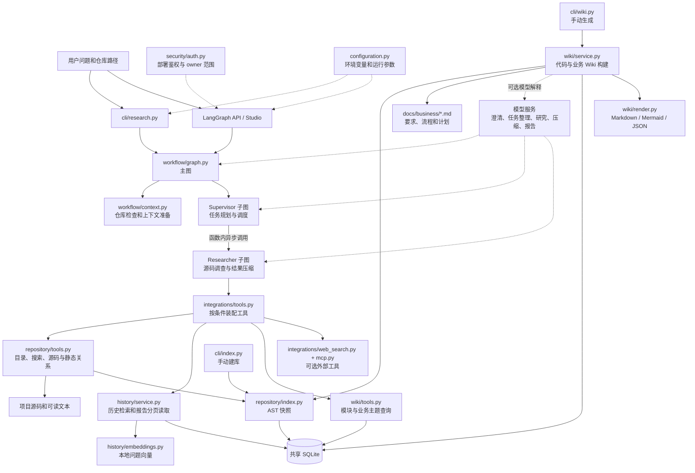
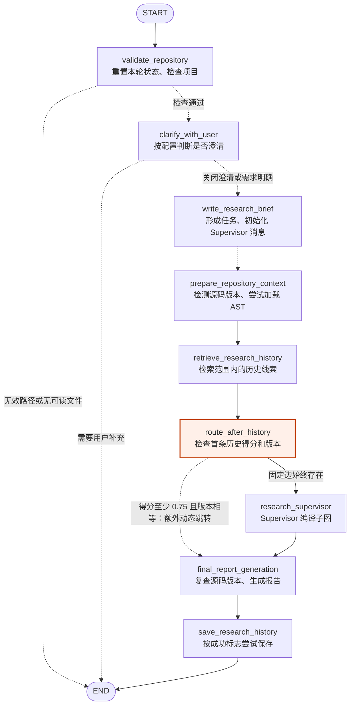
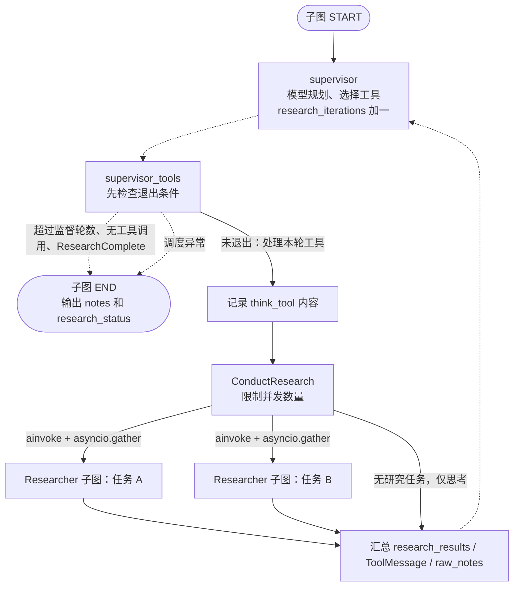
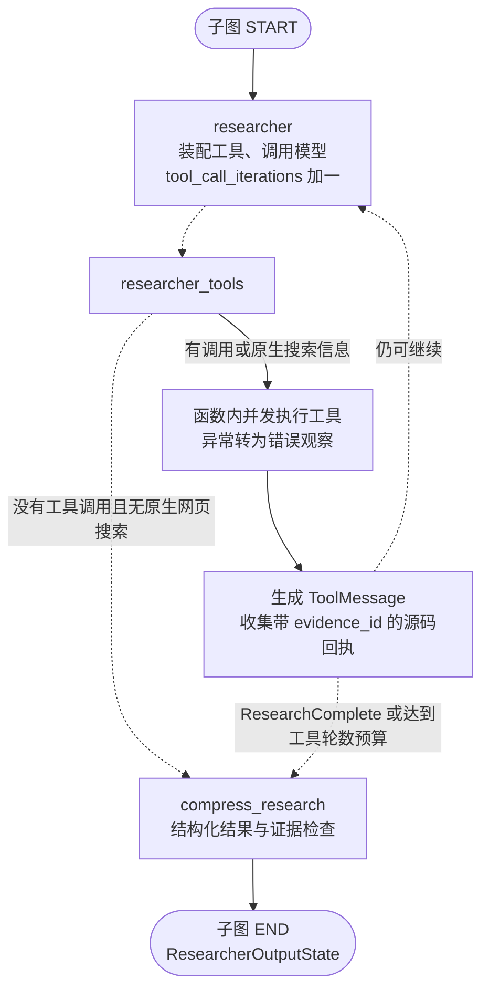
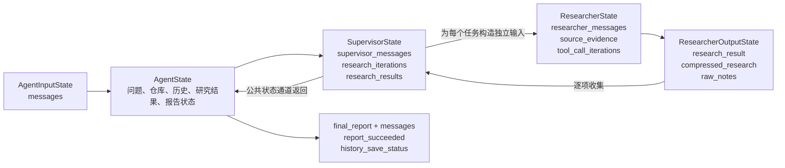
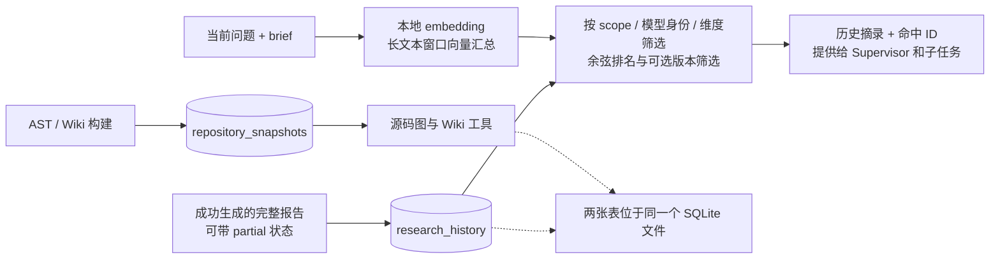

# 项目完整架构与 LangGraph 编排

核对日期：2026-09-29。本文描述当前实现，不把计划中的能力画成已实现功能。
图定义来自 `workflow/graph.py`、`workflow/context.py`，并与实际编译图导出结果交叉核对。

## 1. 项目整体架构

项目由三条入口组成：在线研究、显式 AST 建库、显式 Wiki 生成。研究流程使用 LangGraph，
AST 与 Wiki 构建使用普通 Python / asyncio 调用；业务数据共用一个 SQLite 文件。



入口与源码：

| 层 | 当前职责 | 主要文件 |
|---|---|---|
| 命令与服务 | 研究、AST 建库、Wiki 生成；注册服务图 | [research.py](../src/open_deep_research/cli/research.py)、[index.py](../src/open_deep_research/cli/index.py)、[wiki.py](../src/open_deep_research/cli/wiki.py)、[langgraph.json](../langgraph.json) |
| 工作流 | 主图与两层循环；状态、提示词和仓库准备 | [graph.py](../src/open_deep_research/workflow/graph.py)、[state.py](../src/open_deep_research/workflow/state.py)、[prompts.py](../src/open_deep_research/workflow/prompts.py)、[context.py](../src/open_deep_research/workflow/context.py) |
| 源码知识 | 安全路径读取、版本指纹、AST 符号与关系 | [tools.py](../src/open_deep_research/repository/tools.py)、[index.py](../src/open_deep_research/repository/index.py) |
| 历史知识 | 问题与报告存储、范围隔离、本地向量排名 | [service.py](../src/open_deep_research/history/service.py)、[embeddings.py](../src/open_deep_research/history/embeddings.py) |
| Wiki | 静态图、业务要求关联、模型解释、导出及查询 | [service.py](../src/open_deep_research/wiki/service.py)、[business.py](../src/open_deep_research/wiki/business.py)、[graph.py](../src/open_deep_research/wiki/graph.py)、[render.py](../src/open_deep_research/wiki/render.py)、[tools.py](../src/open_deep_research/wiki/tools.py) |
| 模型与集成 | 工具装配、网页搜索、MCP 鉴权、模型辅助 | [tools.py](../src/open_deep_research/integrations/tools.py)、[web_search.py](../src/open_deep_research/integrations/web_search.py)、[mcp.py](../src/open_deep_research/integrations/mcp.py)、[models.py](../src/open_deep_research/integrations/models.py) |
| 存储与部署 | 两张业务表、部署身份与资源范围 | [database.py](../src/open_deep_research/storage/database.py)、[auth.py](../src/security/auth.py) |

旧 `code_workflow.py`、`repository_knowledge.py`、`deep_researcher.py` 是兼容入口。
`configuration.py` 控制参数，环境变量优先于运行配置。CLI 研究不经过部署鉴权中间件。

## 2. LangGraph 主图：人工核对的实际路径

实线表示固定 `add_edge`；虚线表示函数返回 `Command(goto=...)`。红色节点存在额外动态分支，
不能把它画成互斥选择：动态跳转不会替代已经注册的固定边。



主图是 **9 个业务节点**，另有 START / END。关键分支：

| 节点 | 当前行为 |
|---|---|
| validate_repository | 路径无效、无法读取或没有支持的文件：输出提示并结束；开始新问题时重置历史状态、研究结果、笔记和迭代数 |
| clarify_with_user | 默认关闭；开启且需要澄清时输出问题、结束本轮，不在图内等待用户 |
| prepare_repository_context | 分别尝试文本版本指纹和 AST 索引加载；失败记为 unknown/unavailable，仍继续 |
| retrieve_research_history | 关闭、空问题、未命中、模型或数据库错误均可降级继续 |
| route_after_history | 首条历史 score ≥ 0.75 且 revision 等于本轮版本时，用摘录填充 notes 并动态跳向报告；条件本身没有额外检查版本非空 |
| final_report_generation | 已知版本变化／无法复查时拒绝生成和保存本轮报告；模型错误后报告成功标志为 false |
| save_research_history | 关闭或 report_succeeded=false 时不写入；保存错误不抹去已生成的回答；partial 报告可保存其状态 |

**现有路由问题：**高相似历史命中时，报告分支和固定研究分支都可能被调度，导致额外报告调用。
这也是之前 3 个历史流程测试失败涉及的路径。本文忠实展示现状，没有修改该业务行为。

## 3. Supervisor 子图与并发调度



图中的 think、fanout、collect 是 `supervisor_tools` 函数内部步骤，**不是独立注册节点**。
真正的 Supervisor 子图只有 `supervisor`、`supervisor_tools` 两个业务节点。
Researcher 通过函数内 `researcher_subgraph.ainvoke(...)` 调用，不是主图中的固定边或 `Send` 节点。

每个子任务独立收到任务描述、仓库上下文、选定的历史摘录、history_ids 和 verification_targets。
兄弟子任务不共享消息列表；必要的前次发现需由 Supervisor 写进后续任务描述。
超过并发上限的请求不会执行，会作为工具错误返回；单个子任务异常转换为 failed 结果，其他任务仍汇总。

## 4. Researcher 子图与工具循环



execute 和 receipts 是函数内部步骤。实际子图仅有 researcher、researcher_tools、compress_research 三个业务节点。
压缩结果包括 summary、status、unresolved_questions、history_assessments；程序追加实际 evidence 和 research_topic。
历史声明只能引用本轮实际证据 ID；没有证据的声明降为 unverified。预算耗尽、缺少源码证据或仍有未解问题时，结果标为 partial。
压缩最多尝试 3 次，失败返回 failed 结果。

| 工具组 | 装配条件 | 主要工具 |
|---|---|---|
| 基础 | 默认装配 | think_tool、ResearchComplete |
| 源码 | 配置了可读仓库 | list_repository_files、search_repository、read_repository_file |
| AST | 索引存在且版本有效 | resolve_symbol、read_code_symbol、query_code_graph |
| 历史 | 历史开启且本轮有匹配记录 | read_research_history；限定检索到的 ID 和当前 scope |
| 模块 Wiki | Wiki 开启、存在且源码／业务文档版本有效 | list_project_wiki、read_project_wiki、query_wiki_graph |
| 业务 Wiki | 有效 Wiki 中存在业务主题 | list_business_topics、read_business_topic、query_business_graph |
| Web | repository_allow_web=true | Tavily 或模型提供商原生搜索 |
| MCP | 配置了服务及工具 | 从 MCP 服务发现并筛选；可用 OAuth 鉴权 |

## 5. 退出条件与模型调用边界

以下默认值来自 `Field(default=...)`，不是配置 UI 中可能滞后的 metadata.default；环境配置可覆盖。

| 控制 | 代码默认 | 实际含义 |
|---|---:|---|
| allow_clarification | false | 默认直接整理任务，不额外询问 |
| max_concurrent_research_units | 2 | 一轮最多执行两个研究子任务 |
| max_researcher_iterations | 2 | Supervisor 在模型调用后检查 `research_iterations > 2`；可能调用第 3 次模型，然后不再执行新任务 |
| max_react_tool_calls | 5 | Researcher 在工具执行后检查 `tool_call_iterations >= 5`；是轮数，不是单个工具总数 |
| ResearchComplete | 模型选择 | 显式结束信号，不等同于结论正确 |
| 无工具调用 | 退出分支 | Supervisor 结束；Researcher 无原生搜索时转压缩 |

目前没有已接入的特定 JEV 框架，也没有独立的停滞检测节点。退出依赖上述条件。
监督层仅在收到 ResearchComplete、存在研究结果且全部标为 completed 时，将整体标为 completed，否则为 partial。
本说明没有承诺严格的总运行时间上限；图轮数预算不是远程服务超时机制。

模型职责分别是：澄清／任务整理与研究使用 research_model，压缩使用 compression_model，
报告使用 final_report_model，网页摘要使用 summarization_model；Wiki 构建使用 wiki_model，
未指定时回退 research_model。历史 embedding 是独立的本地模型，不负责生成报告。

## 6. 状态流转与数据归并



- Agent 的 messages 继承 LangGraph MessagesState；Researcher 消息与源码证据使用列表追加。
- supervisor_messages、research_results、notes、raw_notes 使用 override_reducer：普通列表追加，
  `{"type":"override","value":...}` 可覆盖，避免新问题混入旧轮结果。
- 历史上下文是有长度限制的摘录，完整报告通过分页工具读取；Wiki 也是按需查询，不整库塞入提示词。
- 主图直接 `compile()`，代码未指定本地 checkpointer。会话 checkpoint 与业务 SQLite 是不同职责；
  服务运行环境可管理会话，测试中单独使用 InMemorySaver。业务库不保存完整消息与工具调用轨迹。

## 7. AST、Wiki 与业务知识构建链路

```mermaid
flowchart TD
  ci[cli/index] --> scan[扫描 Python 源码]
  cw[cli/wiki] --> docs[读取仓库内业务 Markdown]
  cw --> scan
  scan --> ast[AST<br/>模块、类、函数、方法<br/>包含、导入、调用、继承]
  ast --> snapshot[repository_snapshots.data<br/>版本化源码快照]
  ast --> graph[wiki/graph.py<br/>模块依赖与源码证据]
  docs --> topics[wiki/business.py<br/>H2 主题与声明元数据]
  topics --> links[关联业务要求、计划、代码和测试<br/>缺失和歧义保留标记]
  graph --> links
  links --> static[静态 Wiki<br/>主题、关系、引用]
  static -.->|可选模型模式| llm[模块解释与业务差异分析<br/>双来源引用检查]
  llm --> version[复查源码及文档版本]
  static -->|no-llm| version
  version --> persist[原快照内 wiki 字段<br/>没有新增业务表]
  persist --> export[Markdown 模块页与业务页<br/>Mermaid 关系图 + graph.json]
  persist --> runtime[研究时按需读取<br/>过期则不装配 Wiki 工具]
```

此链路不属于 LangGraph 节点编排。静态模式不调用 LLM；模型模式的说明均为 generated_unverified。
文档声明不保证实现符合规则，HAS_TEST 也不保证测试已通过；model_inferred 关系保持待核实。
Wiki 版本合并 AST source_revision、业务文档哈希及目录配置。普通 AST 重建会替换快照、清除旧 Wiki。
默认导出目录 `.repository-wiki/` 被源码扫描忽略，防止生成物反过来污染知识来源。

## 8. 共享数据库与历史 RAG



| 表 | 主键及字段 | 含义 |
|---|---|---|
| repository_snapshots | root；data JSON | 每个仓库一个当前快照，包含 files、nodes、edges、diagnostics；wiki 字段保存模块与业务知识 |
| research_history | id；scope、question、brief、report、created_at、model_identity、dimension、vector、metadata | 一条研究问题／报告对应一条记录和一个汇总向量；metadata 保存版本、证据相关结果与历史关联 |

默认文件 `.research-history/history.sqlite3`；新配置 `research_database`，兼容旧 `history_database`。
历史 scope 包含用户身份或本地标识、namespace、仓库路径。它不是企业组织 RBAC 系统。
没有单独向量数据库，也没有 Neo4j；静态关系存在 JSON 中，由 Python 查询。

## 9. 图文件与核对方法

**自动导出（未人工增补）：**

- [主图 Mermaid](diagrams/langgraph-main.mmd)
- [Supervisor Mermaid](diagrams/langgraph-supervisor.mmd)
- [Researcher Mermaid](diagrams/langgraph-researcher.mmd)
- [三个编译图的节点／边 JSON](diagrams/langgraph-compiled.json)

**人工核对图：**本文的 7 张 Mermaid 图另存为 `diagrams/architecture-01.mmd` 至 `architecture-07.mmd`。

自动图来自 `compiled_graph.get_graph().draw_mermaid()`。它不能完整反映函数内部的条件和调用：
`route_after_history` 没有声明 `Command[Literal[...]]` 返回目标，当前自动图遗漏了动态报告出口；
Researcher 的函数内异步调用也不会作为 Supervisor 的普通拓扑边显示。理解运行行为应结合本文与源码。

本次只导出和检查图定义，没有调用真实研究模型、运行研究流程或更改路由。
新增文档位于 `docs/`，不在 `docs/business/` 内；不会更改 Wiki 的业务文档版本。
