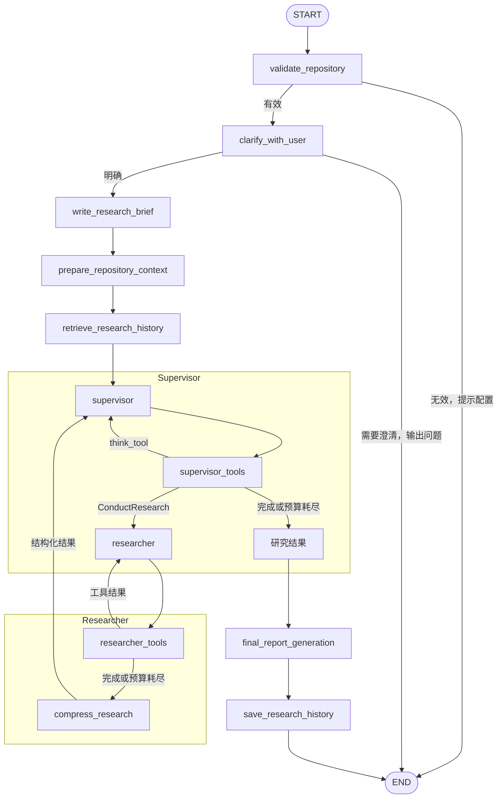

# 当前代码研究工作流

## 实际编排

Supervisor 接收任务、仓库能力与历史线索，决定一个还是多个研究任务。结构／语义／开放是规划策略，不是独立分类节点或三条回答分支。每个子任务独立运行同一 Researcher 循环。独立任务并发，依赖任务由 Supervisor 在后续轮次分配。

`prepare_repository_context` 只探测，不自动建库。索引缺失、过期、损坏时标记不可用；版本扫描失败时版本未知。上述情况均不阻断研究。版本标识是纳入读取范围的文本文件内容哈希，不要求 Git，也不等于 Git commit。

## 工具和证据

始终提供 `list_repository_files`、`search_repository`、`read_repository_file`。只读取指定项目中的支持文本类型，遵循 Git 忽略规则，排除环境目录、`.env` 等文件和符号链接。目录／搜索支持分页；源码按行读取，返回 path、行号、文件哈希、evidence_id 和 next_line。文件、查询和输出有大小上限。

有效 AST 索引增加 `resolve_symbol`、`read_code_symbol`、`query_code_graph`。索引变旧后工具调用返回错误，Researcher 应回退到搜索／读取；不会静默使用旧关系。AST 只解析 Python，动态分派可能 unresolved，多个同名符号可能 ambiguous；implementations 仅为声明的继承关系。其他支持的文本语言可直接阅读，不声称有对应 AST 能力。

网页按 `repository_allow_web` 开启，MCP 按 `mcp_config` 开启，始终保留基础工具。网页支持外部文档比较，不能代替本地源码证明仓库行为。

每次研究保留文件哈希；已知全库版本时，读取和最终输出检查源码变化。发生变化或结束时无法确认版本，则提示重跑，不保存混合版本报告。版本未知时只提供逐文件读取时的哈希，不能保证整次研究的一致快照。

## 代码索引存储

AST 与历史记录共用 `research_database` 指定的 SQLite 文件（默认 `.research-history/history.sqlite3`）。`repository_snapshots` 表以仓库绝对路径 `root` 为主键，每个仓库保存一条版本化 JSON 数据，重建只更新该仓库。schema=2 包括 root、revision、files（源码和哈希）、nodes、edges、diagnostics。没有模块或函数向量。查询加载到内存后由 Python 处理，不是 SQL 图查询，也不是保存完整 AST 对象。旧 `.repository-knowledge/*.sqlite3` 不再读取，需手动重建到共享库；旧文件不删除。

这是轻量全量快照；大仓库增量建库不在当前范围。索引构建有 10000 个 Python 文件、单文件 1 MB、总源码 30 MB 上限。超限不影响已能使用的基础研究入口，但工具本身也有读取预算。

## 历史 RAG 的完整链路

1. `write_research_brief` 根据对话整理任务。
2. 使用问题＋brief 的 embedding 检索相似记录。保存一条研究一条向量；完整报告不切成向量片段。
3. 返回有长度预算的历史摘要／摘录与记录 ID，传给 Supervisor。
4. `ConductResearch` 可选 history_ids 和 verification_targets。调度节点从实际命中中筛选，显式传入子任务；省略 IDs 则传入本轮已检索线索。
5. Researcher 可通过 `read_research_history` 分页读取本轮命中的完整报告，不能凭任意 ID 跨范围读取。
6. Researcher 阅读当前源码；压缩节点返回 `ResearchResult`，包含 summary、history_assessments、unresolved_questions、status。实际源码工具返回的证据元数据由程序追加。
7. 历史判断为 verified/corrected/unverified；没有本次实际 evidence_id 的判断会降为 unverified。此检查仅验证引用存在，是否支持语义结论仍需评测，不能视为自动证明。
8. Supervisor 收到结构化结果，选择补充研究或结束；最终报告同时获得研究结果、历史参考和完成状态。
9. 成功生成的报告写回历史；partial 报告保留状态和缺口，失败的报告不保存。保存失败不影响已有回答。

共享数据库的 `research_history` 表保存问题、brief、完整报告、向量及 metadata；已有历史记录和向量继续使用。metadata 包含版本、研究结果、证据引用、关联历史 IDs、完成状态。scope 按用户、namespace、项目路径隔离；版本已知时只检索同版本，未知时可检索同项目记录但所有历史仍须验证。统一连接初始化两张业务表，AST 构建不加载 embedding 模型。通过 `RESEARCH_DATABASE` / `research_database` 或 CLI `--database` 配置路径，环境变量优先；旧 `HISTORY_DATABASE` / `history_database` 作为未配置新路径时的兼容选项。

数据库兼容添加 metadata 列；新向量身份追加 `question-brief-v2`，不会混用旧问题单独向量。原项目＋版本编码进 scope 的旧记录保持存储，但不会自动迁移进新范围或作为新版本事实。

历史持久化是应用数据，独立于 Engramory。这里不存每条聊天和所有工具调用的完整轨迹；聊天连续性由 LangGraph 会话状态负责。

## 降级和预算

- 缺少有效项目：结束并提示路径。
- 需求不明确：原澄清节点提问，本轮结束。
- 无索引／无版本／历史失败：继续 Supervisor。
- 一个并发子任务失败：返回失败结果，其他子任务仍汇总。
- Researcher 预算耗尽：partial；缺少源码证据或存在未解决问题也不能标记 completed。
- 最终生成失败：不保存历史。历史写入失败：返回报告并记录 save_error。

## 验证与后续评测

运行 README 的两个验证命令。单元／集成测试覆盖四种索引和版本场景、历史从 Supervisor 到 Researcher 再到报告、澄清和路径停止、工具组合、跨项目/用户/版本隔离、分页读取、预算与伪造引用降级、并发子任务上下文隔离，以及源码变化拒绝混合报告。

对真实模型另建人工标注的问题集。分别运行历史关闭和开启，比较：

- 历史检索 Recall@k：应命中的历史记录有多少被找回。
- 源码证据支持率：回答中的关键事实，有多少由引用源码支持。
- 历史核实正确率：verified/corrected/unverified 判断是否符合源码。
- 完成质量、工具调用数、总耗时和 token 成本。

测试通过说明链路正确，不代表历史一定提速，或生成结论天然正确。默认没有执行付费远程 LLM 测试。
